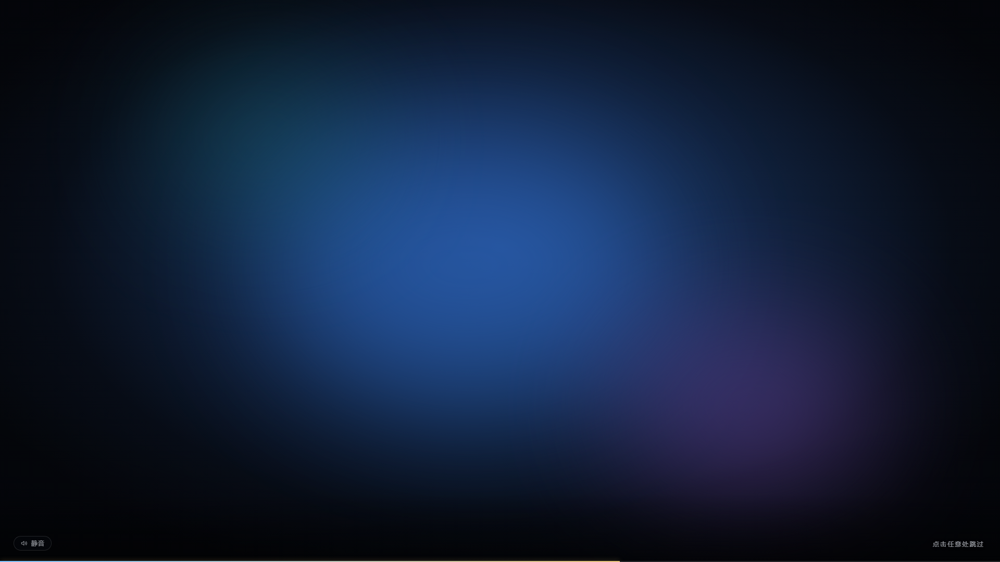

# 开机动画 · dsh-boot-animation

[English](README.en.md) · **简体中文**

> 给 **DeepSeek Harness** 的 Web 界面加一段全屏开场动画：打开窗口时铺满整屏播一遍，播完淡出进入主界面。
> 点一下就能跳过，默认带声音，和壁纸插件 `dsh-plugin-wallpaper-engine` 共处一屏互不干扰。

<!-- 示意图：overlay 的版式（播放区 / 暗角 / 进度条 / 跳过提示 / 静音按钮），不是某段视频的截图 -->


---

## 它做了什么

| 时机 | 行为 |
| --- | --- |
| 打开 / 重启 DSH 窗口 | 全屏播一遍开机视频，播完 650 ms 淡出，露出界面 |
| 界面内切页、重渲染 | **不会**重播（一次窗口生命周期只播一次） |
| 点击任意位置、`Esc`、`Enter`、空格 | 立即淡出跳过 |
| 视频比预期长 | 26 秒硬上限兜底，绝不卡在黑屏 |
| 视频缺失 / 损坏 | 整层不渲染，直接进界面（不闪黑） |

## 特性

- **任何 mp4 都能当开机动画** —— 换成自己的片头、公司 logo、番剧 OP 都行。
- **Range 流式传输** —— 视频走 HTTP `206` 分片，几百 MB 的片子也不会被整个读进内存。
- **自动播放兜底** —— 浏览器拒绝"带声音的自动播放"时自动退回静音，左下角小喇叭随时可开声。
- **和壁纸插件共存** —— 独立浮层 + 正 z-index，全程不读写壁纸插件的 DOM 与状态，播完把自己完整卸载。
- **中英文案** —— 文案走 DSH 的 locale 服务，跟随界面语言。
- **优雅降级** —— 没准备好视频时插件安静地什么都不做，不报错不黑屏。

## 安装

### 方式一：本地目录安装（推荐）

```bash
git clone https://github.com/lzyzuo/dsh-boot-video.git
```

然后在 DSH 里把 **这个目录** 当作插件包安装（插件管理 → 安装本地插件，选择 `dsh-boot-animation/package.json` 所在目录），
安装完**重启 DSH 窗口**即可看到效果。

### 方式二：手动放进 profile

把整个目录复制到 `<profile>/node_modules/@local/dsh-boot-animation/`，并在 profile 的 `cordis.patch.yml` 里加上：

```yaml
- insert:
    - id: boot-animation
      name: '@local/dsh-boot-animation'
      config:
        enabled: true
        sound: true
```

重启 DSH 生效。

## 换上你自己的视频

> ⚠️ **本仓库不附带任何视频文件。** 一是版权（示例里用的高达片头属于万代 / 日升），二是仓库不该塞几十 MB 的二进制。
> 想直接用现成的，请自己准备一段你有权使用的视频。

视频放在插件目录下，两种方式任选：

1. 放到 `media/boot.mp4`（保持文件名，`media/` 目录已在 `.gitignore` 里，不会被误提交）；
2. 或者在配置里指向任意路径（绝对路径，或相对插件目录）：

```yaml
config:
  file: 'D:/videos/my-boot.mp4'
```

**对视频的建议**：16:9、1920×1080 以内、20 秒以内、`H.264 + AAC` 的 mp4 —— 这是浏览器兼容性最好的组合。
画面两端留点安全边距，因为 `object-fit: cover` 会在非 16:9 的窗口里裁掉边缘。

## 配置项

在 `cordis.patch.yml` 里（或插件页的配置里）调整：

| 键 | 类型 | 默认 | 说明 |
| --- | --- | --- | --- |
| `enabled` | boolean | `true` | `false` 彻底关闭；关闭后连视频路由都不会注册 |
| `sound` | boolean | `true` | `false` 则默认静音开场 |
| `file` | string | `media/boot.mp4` | 自定义视频路径 |

改完配置需要重启 DSH 窗口才生效（插件代码也在重启时重新加载）。

## 和壁纸插件为什么不打架

| | 壁纸插件 | 本插件 |
| --- | --- | --- |
| 挂载位置 | `body` 上的 `.we-layer` | `shell.overlay` 槽位里的独立浮层 |
| 层级 | `z-index: -2`（遮罩 `-1`） | `z-index: 2147483000` |
| 交互 | 壁纸层不接收指针事件 | 播放期间独占指针，结束后整层卸载 |
| 耦合 | —— | 不读写壁纸插件的任何 DOM、属性（`body[data-we-*]`）、状态 |

所以播放时壁纸仍在最底层正常运行，动画结束后直接露出"壁纸 + 界面"，两者可以同时开启。

## 工作原理

**host 半**（`index.js`）注册两条只读路由：

| 路由 | 用途 |
| --- | --- |
| `GET /boot-animation/status.json` | `{"enabled":true,"sound":true,"ready":true}`，`Cache-Control: no-store` |
| `GET /boot-animation/video.mp4` | 带 `Range` 的流式响应（`200` / `206` / `400` / `416`，`Accept-Ranges: bytes`） |

**client 半**（`client.js`）挂在 `shell.overlay` 槽位（`id: boot-animation`，`order: 90000`）：
先问一次 `status.json`，`enabled && ready` 才渲染浮层，避免"先黑屏再消失"的闪烁。

文件结构：

```
dsh-boot-video/
├── index.js            # host：路由 + Range 流
├── client.js           # client：浮层、播放、跳过、静音
├── cordis.patch.yml    # 默认配置
├── locale/{en,zh}.json # 插件页显示名与简介
├── icon.svg            # 插件图标
├── media/              # 放你的 boot.mp4（不入库）
└── docs/preview.png    # 版式示意图
```

## 常见问题

**播了但没声音？**
浏览器自动播放策略：首次进入时若未获得用户手势，带声播放会被拒，插件会自动改静音播放。点左下角小喇叭开声。

**界面没反应 / 没看见动画？**
1. 打开 `http://127.0.0.1:<端口>/boot-animation/status.json`，能返回 JSON 说明 host 半在跑；
2. 看 `ready` 是不是 `false` —— 那说明 `media/boot.mp4` 不存在；
3. 确认 `enabled` 不是 `false`。

**能不能每次切页都播？**
不能，设计上就是"一次窗口生命周期播一次"，切页反复播会打断工作流。

**支持 webm / mov 吗？**
路由按 `video/mp4` 返回，浏览器能解 h264 就够用；其它容器改 `Content-Type` 也能跑，但不保证。

## 开发

```bash
node --check index.js
node --check client.js
```

CI 会跑语法检查与 JSON 校验（见 `.github/workflows/ci.yml`）。

## License

[MIT](LICENSE) © 2026 20411

> 仓库内的示例视频不在授权范围内（且已从仓库移除）。请只使用你有权使用的素材。
